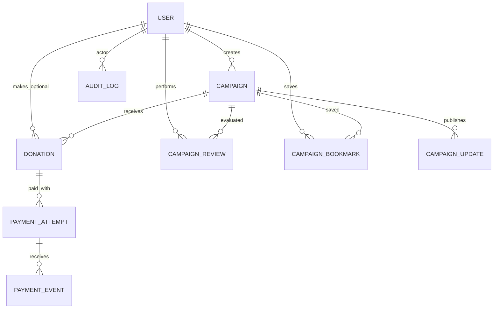

# BAMAS — Model Data dan Kontrak API Target

Dokumen desain untuk fase F2–F4. **Sebagian telah diimplementasikan pada F2; kontrak aktual ada di [F2_SETUP](F2_SETUP.md) dan schema Prisma.** Tabel review, update, payment dan audit di bawah tetap target F3–F4. Gunakan schema versioned dan review sebelum mengubah database.

## Relasi inti

### Tabel minimum

| Tabel | Kolom inti / constraint |
|---|---|
| `User` | id(UUID), name, email(unique), role(default DONOR), createdAt; plus Better Auth Account/Session/Verification sesuai pilihan login |
| `Campaign` | id(UUID), slug(unique), ownerId(FK User), title, story, category, targetIdr(BIGINT), status, reviewedAt, createdAt, updatedAt |
| `CampaignUpdate` | id, campaignId, body, createdAt; authorId |
| `CampaignReview` | id, campaignId, adminId, decision, reason, createdAt; immutable audit |
| `Donation` | id(UUID), campaignId, donorId(nullable untuk guest), amountIdr(BIGINT), status, anonymous, donorMessage, createdAt, paidAt(nullable) |
| `PaymentAttempt` | id(UUID), donationId, provider, merchantOrderId(unique), providerTransactionId(unique nullable), status, expiresAt |
| `PaymentEvent` | id, paymentAttemptId, provider, dedupeKey(unique per provider), observedStatus, receivedAt, processingResult; redacted metadata saja |
| `CampaignBookmark` | userId + campaignId composite unique |
| `AuditLog` | id, actorId, action, resourceId, timestamp, minimal redacted metadata |
| `Disbursement` | **F5+ / future**, tracking and approval penyaluran dana; jangan dibuat live tanpa operasi/legal review |

Semua ID dari server, bukan `Math.random()`/Date.now() sebagai payment key. Tambahkan indeks berdasarkan pola query nyata. Gunakan constraints, migration history dan backup. Hindari field `Campaign.raised` sebagai saldo bebas edit: nilai terhitung dari verified paid donations / ledger terkontrol, atau materialized aggregate yang diperbarui atomik.

### States & transitions

- Campaign `DRAFT -> REVIEW -> ACTIVE | REJECTED` (review oleh admin saja). `ACTIVE -> COMPLETED/CLOSED` melalui rule server yang terdokumentasi; rejected resubmit perlu aturan tersendiri.
- Donation `PENDING -> PAID | FAILED | EXPIRED` dan `PAID -> REFUNDED` hanya dari sumber server terverifikasi. Status terminal tidak boleh ditimpa callback lama. Sebuah PaymentAttempt boleh lebih dari satu per Donation sesuai aturan retry, tetapi hanya satu settlement berdampak pada ledger.
- Pembayaran real: transaksi gateway bisa asynchronous; tidak ada `client set paid` dan tidak ada double count jika event diulang.

## Endpoint target

| HTTP | Path | Akses | Perilaku |
|---|---|---|---|
| GET | `/api/campaigns` | Publik | filter/sort/pagination; hanya aktif |
| GET | `/api/campaigns/[slug]` | Publik | detail hanya yang publik, owner/admin bisa melihat miliknya |
| POST | `/api/campaigns` | Authenticated campaigner | buat DRAFT; Zod validation |
| POST | `/api/campaigns/[id]/submit` | Owner | DRAFT -> REVIEW |
| POST | `/api/admin/campaigns/[id]/review` | ADMIN server-side | approve/reject + reason/audit |
| POST | `/api/donations` | Guest/donor bila diaktifkan | validasi amount, campaign, buat PENDING; return checkout info demo/sandbox |
| GET | `/api/me/donations` | Logged-in donor | hanya donasi sendiri |
| GET | `/api/donations/[id]/status` | Owner/token scoped | baca status dari server; tidak boleh bocorkan data lain |
| POST | `/api/payments/webhooks/[provider]` | Provider-verified | verified, idempotent, atomic settlement |
| GET/POST | `/api/me/bookmarks` | Authenticated | baca/tambah simpan kampanye |

Better Auth handle routes disediakan oleh library. Tidak ada `PATCH donation.status = paid` publik. Rate limit terutama create donation, auth, upload, webhook. Gunakan response JSON typed + structured error code yang stabil.

## Guest & privacy decision

Pengunjung dapat menjelajah tanpa login. Agar janji prototipe “siapa pun bisa berdonasi” tetap relevan, guest donation **boleh dirancang** dengan opaque receipt token berentropi tinggi dan pemisahan izin; jangan membuat endpoint riwayat guest yang bisa ditebak berdasarkan ID. Login dibutuhkan untuk dashboard penggalang dan admin. Pembayaran nyata hanya setelah privacy/compliance review.

## Reliability acceptance

- Request invalid amount/non-INT, negative/zero dan over-limit -> `400/422`.
- Donor A tidak boleh membaca riwayat Donor B; campaigner tidak boleh review kampanye sendiri sebagai admin.
- Callback tanpa tanda valid atau salah nominal/ref -> reject, log redacted.
- Callback identik 2x/10x -> **satu** perubahan ledger; transaksi atomik.
- Callback `PAID` disusul `PENDING` lama -> tetap `PAID` jika aturan provider menyatakan.
- Simulasi & payment live tidak bercampur database/accounting.

## Perbedaan F2 terhadap target
Donor wajib memiliki akun (guest belum diaktifkan). Database F2 berisi User/Session/Account/Verification/RateLimit/Campaign/CampaignBookmark/Donation saja. Status tersedia sebagai enum, tetapi transisi moderasi dan pembayaran belum diimplementasikan. Donation hanya dibaca; fixture tes bukan transaksi. Pengisian paidAt, field reviewedAt, PaymentAttempt/Event dan audit trail menunggu fase terkait.
